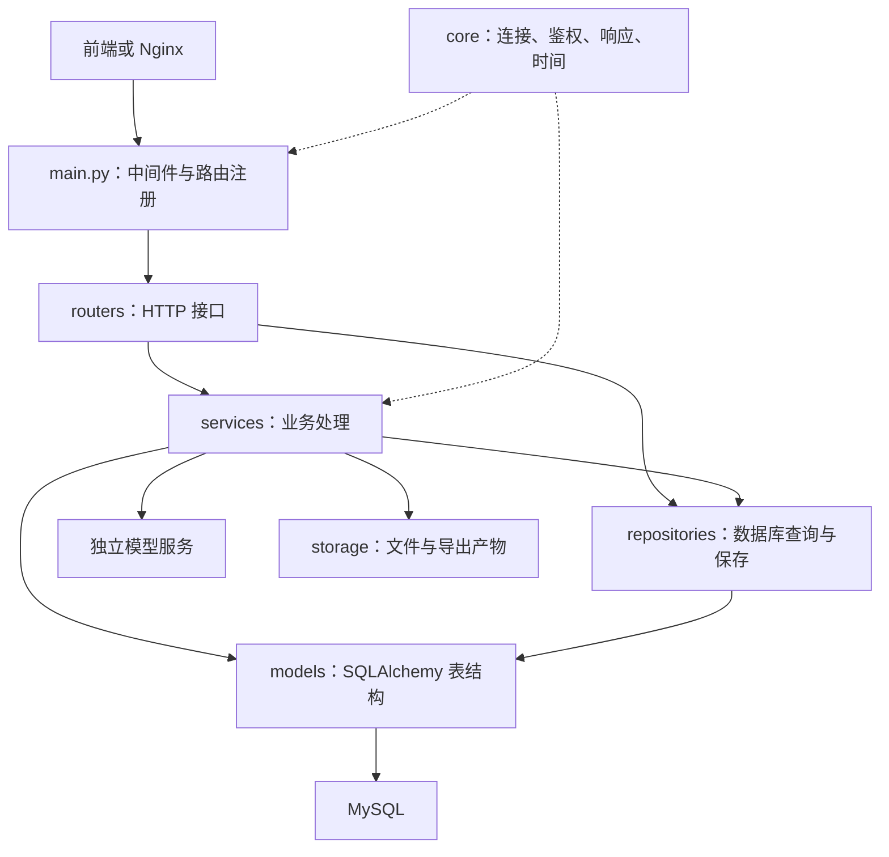

# 后端文件作用与阅读指南

整理日期：2026-11-21。以当前 `Content_Safety_Backend` 工作区实际文件为准，包括尚未提交的源文件。

本文逐项说明应用源代码、脚本、测试、配置、文档和固定数据文件；`.venv`、缓存、上传产物和数据库备份等生成内容按目录说明，不将第三方依赖逐个列为项目代码。未读取或展示 `.env` 中的密码、令牌和认证密钥。

本次清单覆盖 163 个项目文件：`app/` 83 个（包含包标识、固定数据和临时占位文件）、`scripts/` 13 个、`tests/` 46 个、`docs/` 10 个、示例 1 个、CI 配置 1 个、根目录配置/说明 9 个；另说明运行日志等生成内容。这是当前工作区统计，不是仅统计 Git 已提交文件。

## 1. 先理解整体结构

本项目是业务后端，默认使用 FastAPI/Uvicorn 的 `8000` 端口；模型训练、模型推理等真实模型能力还会接入独立的 `content-security-llm` 服务，通常为 `8001`。本目录不是模型权重或全部模型算法所在的位置。

这是主要分工，并非所有接口都严格经过全部层次：当前一些路由和服务直接使用 SQLAlchemy 查询。
`adapters/mock_adapter.py` 和若干历史演示分支仍存在；文件名含 `mock`、注释写“模拟”或文件名含 `real`，均不能代替检查实际执行分支。

| 目录 | 作用 |
| --- | --- |
| `app/core/` | 数据库、认证、响应格式、启动初始化等基础能力。 |
| `app/domain/` | 能力编码目录与 Pydantic 请求/响应模型。 |
| `app/models/` | ORM 模型，即代码中的数据库表结构。 |
| `app/routers/` | URL、请求参数、权限入口和 HTTP 响应。 |
| `app/repositories/` | 常用数据库增删改查和结果序列化。 |
| `app/services/` | 数据接入、版本、治理、评估、合规与智能体轨迹业务逻辑。 |
| `app/adapters/` | 当前保留的模拟能力适配器。 |
| `scripts/` | 手动执行的导入、迁移、校验和联调工具。 |
| `tests/` | 自动化回归测试。 |
| `docs/` | 功能接入、规则、验证和维护说明。 |

## 2. 根目录与持续集成

| 文件 | 作用 |
| --- | --- |
| [app/main.py](../app/main.py) | FastAPI 应用入口。注册路由、CORS、平台登录校验、只读权限、追踪 ID 和异常处理；启动时检查数据库、创建缺失表、执行补列与数据回填，并启动轨迹后台 worker；提供 `/health` 和 `/`。 |
| [README.md](../README.md) | 本地与服务器启动、数据库配置、SQL 恢复、旧库初始化行为及常见启动问题。 |
| [pyproject.toml](../pyproject.toml) | Python 版本要求、运行依赖、开发依赖、pytest 配置和 uv 包源。新增依赖时修改这里。 |
| [uv.lock](../uv.lock) | uv 锁定的依赖解析结果，帮助不同机器安装一致的版本；通常由 uv 维护。 |
| [.python-version](../.python-version) | 项目选择的 Python 版本，供 uv 等工具使用。 |
| [.env.example](../.env.example) | 环境变量示例，包括 MySQL、可选 SSH 和轨迹来源开关；不是当前运行环境的真实凭据。 |
| [.env](../.env) | 当前机器实际环境配置，由数据库模块加载；已有系统环境变量可能覆盖文件值。属于本机配置，不应提交凭据。 |
| [.gitignore](../.gitignore) | Git 忽略规则，覆盖环境文件、缓存、日志、`storage/` 和本机数据库备份等。 |
| [LICENSE](../LICENSE) | 项目许可证。 |
| [FastAPI后端逐步学习教程.md](../FastAPI后端逐步学习教程.md) | 学习与演进教程，可用于了解历史分层思路；具体行为以当前源代码为准。 |
| [.github/workflows/ci.yml](../.github/workflows/ci.yml) | GitHub CI：在 main 分支推送、PR 等触发条件下安装 uv 依赖并运行 pytest。 |

启动时会写库的关键入口是 `main.py:lifespan()`，不能将启动理解为只加载 HTTP 服务。`create_all()` 创建缺失表，但不等于完整迁移任意旧库。

## 3. 基础能力：app/core

| 文件 | 作用与主要入口 |
| --- | --- |
| [database.py](../app/core/database.py) | 读取 MySQL/SSH 配置，构建 SQLAlchemy `engine`、`SessionLocal` 和 ORM 基类 `Base`；提供 `get_db()` 请求会话、连接测试和连接关闭；支持校验主机公钥的 SSH 隧道连接。 |
| [auth.py](../app/core/auth.py) | PBKDF2 密码哈希与验证、HMAC 登录令牌签发和验证、账号权限层级；管理 `AUTH_SECRET` 或持久化认证密钥。 |
| [response.py](../app/core/response.py) | `success()/fail()` 统一响应结构，以及追踪 ID 的设置、读取和恢复。 |
| [seed.py](../app/core/seed.py) | 启动兼容处理：部分旧表补列、旧资源迁移、默认账号密码、指标和演示数据初始化、展示字段修正、演示任务补登。存在重复定义的历史函数时，Python 实际使用后定义者；不能只读文件最前面判断行为。 |
| [time.py](../app/core/time.py) | `now_shanghai()`，统一提供项目使用的上海时间。 |
| [audit_logging.py](../app/core/audit_logging.py) | 访问日志过滤器，防止将下载票据等访问能力完整留在 HTTP 日志中。 |
| [_init_.py](../app/core/_init_.py) | 当前为空的历史占位文件。注意单下划线拼写不是 Python 标准 `__init__.py`，没有自动包初始化作用。 |

## 4. 领域模型与适配器

| 文件 | 作用与主要入口 |
| --- | --- |
| [domain/capabilities.py](../app/domain/capabilities.py) | `CAPABILITIES` 能力目录，保存能力编码、中文名、分类等；`is_supported()` 检查能力是否登记。登记能力本身不等于实现算法。 |
| [domain/schemas.py](../app/domain/schemas.py) | Pydantic 数据模型：数据集/模型创建更新、通用任务、训练任务、模型服务登记、模型调用、真实训练同步及统一响应等请求和响应类型。部分专用请求模型也定义在各路由文件内。 |
| [domain/_init_.py](../app/domain/_init_.py) | 空的历史占位文件，不是标准 `__init__.py`。 |
| [adapters/mock_adapter.py](../app/adapters/mock_adapter.py) | `execute_mock_capability()`，按能力编码返回关键词判定、固定数值等演示结果；由任务服务的部分分支调用，不代表真实模型推理。 |
| [adapters/__init__.py](../app/adapters/__init__.py) | 空的标准 Python 包标识。 |

## 5. 数据库模型：app/models

| 文件 | 作用与主要表模型 |
| --- | --- |
| [tables.py](../app/models/tables.py) | 主要业务 ORM 定义：任务、审计日志、数据集、模型、样本记录、模型版本/服务/调用、训练任务、合规审计/告警/证据/评论/谱系边、旧资源表、用户角色、指标及评估任务/运行/事件、数据集版本与版本样本清单等。 |
| [agent_traces.py](../app/models/agent_traces.py) | 智能体轨迹 ORM：批次、快照、投影、样本、事件、工具调用、风险证据、关联关系、来源同步检查点、导出产物、幂等键、上传文件资产、绑定和统计投影等。 |
| [anomaly_reviews.py](../app/models/anomaly_reviews.py) | `AnomalyReview`，持久化异常样本修复候选的人工复核与发布相关状态。 |
| [risk_disposition.py](../app/models/risk_disposition.py) | `RiskDisposition`，持久化风险样本处置、复核和发布相关状态。 |
| [__init__.py](../app/models/__init__.py) | 当前为空的标准包标识；模型注册主要依赖业务模块实际导入相关模型。 |

修改 ORM 后还需考虑旧数据库迁移；已有表不会仅因 Python 字段变更而自动完整升级。

## 6. 数据访问：app/repositories

| 文件 | 作用与主要入口 |
| --- | --- |
| [task_repository.py](../app/repositories/task_repository.py) | 任务保存、更新、按 ID 查询、列表分页，以及任务摘要/详情序列化。开头残留历史模拟实现注释，当前有效定义使用数据库。 |
| [resource_repository.py](../app/repositories/resource_repository.py) | 数据集和模型查询、创建、更新、版本及元数据序列化，同时提供指标查询；包含资源展示口径兼容。 |
| [audit_repository.py](../app/repositories/audit_repository.py) | 保存审计日志，查询全部日志或指定任务日志，并将 ORM 日志转为接口数据。 |
| [evaluation_repository.py](../app/repositories/evaluation_repository.py) | 评估结果记录保存、列表读取、状态与结果序列化；提供启动时调用的演示评估记录补登。 |
| [user_repository.py](../app/repositories/user_repository.py) | 用户列表查询与序列化，为系统管理展示提供数据。 |
| [role_repository.py](../app/repositories/role_repository.py) | 角色、权限列表查询与序列化。 |
| [_init_.py](../app/repositories/_init_.py) | 空历史占位文件，不是标准 `__init__.py`。 |

## 7. HTTP 接口：app/routers

以下为路由职责与代表性路径，省略大部分 `/api/v1` 公共前缀；不是完整 OpenAPI 清单。

| 文件 | 作用与接口范围 |
| --- | --- |
| [auth.py](../app/routers/auth.py) | 平台登录和当前身份：`/auth/login`、`/auth/me`。检查账号状态、密码，并签发平台令牌。 |
| [tasks.py](../app/routers/tasks.py) | 统一能力执行、任务列表和详情、数据处理任务创建；分派轨迹专用任务或通用任务，关联处理规则执行。 |
| [resources.py](../app/routers/resources.py) | 数据集/模型创建查询、数据集更新删除与版本查询、指标、用户角色、告警等资源接口。 |
| [data_resources.py](../app/routers/data_resources.py) | 数据资源概览、筛选项、容量/来源/语言/质量/使用情况等聚合，主要是 `/data-resources/options` 与 `/summary`。 |
| [data_governance.py](../app/routers/data_governance.py) | 数据治理工作区：版本样本、异常检测/修复预览、价值与风险治理结果、概览、筛选和结果恢复；包含历史演示与缓存兼容逻辑。 |
| [anomaly_reviews.py](../app/routers/anomaly_reviews.py) | 异常修复人工复核接口：候选操作、审批移除、变更集校验、生成新版本；在请求层校验结果范围、权限及复核上下文。 |
| [risk_dispositions.py](../app/routers/risk_dispositions.py) | 风险样本处置接口：读取状态、更新样本处置、发布预览和发布新版本；校验结果与授权范围。 |
| [files.py](../app/routers/files.py) | `POST /files` 上传：检查文件类型和大小、分块写文件、计算 SHA-256，并登记轨迹文件资产。它不是完整的数据集接入或批次解析入口。 |
| [capabilities.py](../app/routers/capabilities.py) | `/capabilities`，返回已登记能力目录供前端展示。 |
| [kpis.py](../app/routers/kpis.py) | `/kpis`，根据页面 kind 聚合任务、资源、模型等指标，保持部分卡片与业务列表口径一致。 |
| [audit.py](../app/routers/audit.py) | 审计日志、任务日志和系统日志查询，补充可读的对象名称。 |
| [model_workbench.py](../app/routers/model_workbench.py) | 模型管理与服务工作区、版本/评估展示、模型服务登记升级停止删除、真实服务探活、模型调用流水登记与任务补挂。 |
| [training_tasks.py](../app/routers/training_tasks.py) | 演示训练推进、真实训练代理建单与台账登记、脚本目录、进度/指标/产物/下载代理、模型服务训练结果同步和产物版本补登。 |
| [model_comparison.py](../app/routers/model_comparison.py) | 创建编辑前后真实模型对照评估，读取对照任务进度；将 HTTP 请求交给对照服务处理。 |
| [evaluations.py](../app/routers/evaluations.py) | 测试评估：指标及修订、来源和预检、评估任务/运行/结果/证据，以及合规审计快照的创建和读取。 |
| [compliance.py](../app/routers/compliance.py) | 合规概览、问题汇总、上下文、谱系图和边、审计详情、复核/告警及错误评论等接口。 |
| [compliance_events.py](../app/routers/compliance_events.py) | `/compliance-events` 及其概览：按训练等上下文查询生命周期事件、风险级别和分页记录。 |
| [agent_traces.py](../app/routers/agent_traces.py) | 智能体轨迹统一 HTTP 入口：接入/统计/思维路径/工具交互、批次创建与文件绑定删除、样本详情、批次报告、导出下载票据与二进制下载。 |
| [__init__.py](../app/routers/__init__.py) | 空的标准包标识，不包含 HTTP 路由业务。 |

## 8. 通用业务服务：app/services

| 文件 | 作用与主要入口 |
| --- | --- |
| [task_service.py](../app/services/task_service.py) | 通用任务执行与写库编排。`run_mock_task()` 是历史名称，内部既有真实文件/数据库接入、任务与日志保存、编辑版本登记等，也有调用模拟适配器的分支；不能将整个文件都当作模拟。 |
| [resource_service.py](../app/services/resource_service.py) | `create_new_dataset()`，将创建请求整理后交给资源仓储保存，并登记创建审计日志。 |
| [resource_display.py](../app/services/resource_display.py) | 来源名称规范化及稳定的资源/任务展示默认值；部分规则是原型展示口径，不等于真实文件容量或算法测量值。 |
| [file_ingest.py](../app/services/file_ingest.py) | 将已上传的受支持文件转换为待接入的样本记录，处理内容、表格行、原始字节哈希、标签等；供数据接入任务使用。 |
| [database_ingest.py](../app/services/database_ingest.py) | 外部 MySQL 接入：校验来源连接与受限制的只读查询、流式读取有限条数、规范化 JSON、计算内容哈希并保存平台样本记录。 |
| [dataset_version_service.py](../app/services/dataset_version_service.py) | 数据集不可变版本清单：版本 ID 分配、按主键或标签解析、样本归属校验、清单哈希、接入快照登记、启动补登，以及覆盖式重导时的台账清理。 |
| [process_execution.py](../app/services/process_execution.py) | 实际执行部分数据处理规则：精确去重、文本/编码规范化、字段补全；新增派生样本，保存前后对比，登记输出版本和谱系。 |
| [governance_versions.py](../app/services/governance_versions.py) | 治理流程共用版本范围对象、数据集与版本归属校验、版本样本成员查询及新版本标签分配。供复核和处置服务复用。 |
| [anomaly_reviews.py](../app/services/anomaly_reviews.py) | 异常修复复核状态转换、候选审批/驳回、变更集和发布前版本检查、生成新版本。保留原输入版本。 |
| [risk_dispositions.py](../app/services/risk_dispositions.py) | 风险样本处置状态和审批记录、批准项预览、脱敏/排除等处置发布与版本登记。 |
| [lineage_service.py](../app/services/lineage_service.py) | 谱系边台账：为接入、处理、训练、模型调用登记稳定且幂等的来源/产出关系；补登历史边并提供统计。 |
| [compliance_service.py](../app/services/compliance_service.py) | 从任务、模型、训练、版本等业务事实构造合规证据与审计/告警视图；维护合规读模型，执行部分确定性审计任务。 |
| [compliance_event_service.py](../app/services/compliance_event_service.py) | `add_event()`，训练/推理生命周期合规事件的统一写入入口，供其他业务复用。 |
| [audit_evaluation.py](../app/services/audit_evaluation.py) | 冻结合规审计来源快照，以已保存证据计算评估指标，并验证来源和结果完整性；读取真实训练产物时通过模型服务取得证据。 |
| [risk_evaluation_service.py](../app/services/risk_evaluation_service.py) | 读取已完成的治理检测任务、校验模型服务来源授权、冻结样本与标签、登记风险评估指标并计算结果；不是重新调用模型做检测。 |
| [model_comparison.py](../app/services/model_comparison.py) | 真实模型编辑前后对照评估：冻结相同题集、校验评估绑定、通过服务器令牌调用模型服务、计算指标、归档证据/哈希、保留部分失败，并恢复重启中断任务。 |
| [__init__.py](../app/services/__init__.py) | 空的标准包标识。 |
| [_write_test.tmp](../app/services/_write_test.tmp) | 当前 3 字节的临时文件，不是被导入执行的 Python 业务模块。 |

## 9. 智能体轨迹专用服务：app/services/agent_trace_*

这些文件共同支撑“轨迹接入与校验、统计指标、思维路径、工具交互”四页。页面不与后端文件一一对应，同一份固定快照可以被多个投影读取。

| 文件 | 作用与主要入口 |
| --- | --- |
| [agent_trace_ingest.py](../app/services/agent_trace_ingest.py) | 接入主流程：上传文件资产登记、批次创建、原子绑定、删除与文件引用清理、输入记录读取、格式识别与归一化、解析任务提交、不可变快照发布和任务执行。 |
| [agent_trace_trajectory.py](../app/services/agent_trace_trajectory.py) | 外部智能体 `events/tool_events` JSONL 格式适配器，保留事件身份、工具调用关联及源记录字段；含格式示例。 |
| [agent_trace_internal.py](../app/services/agent_trace_internal.py) | 内部模型调用采集入口 `record_model_call()`，将真实内部消息与响应保存为可审计轨迹，处理幂等；不虚构缺失的工具过程。 |
| [agent_trace_sources.py](../app/services/agent_trace_sources.py) | 统一来源策略：旧价值结果同步开关、批次可见性和来源标识；供目录、解析和 worker 共用。 |
| [agent_trace_sync.py](../app/services/agent_trace_sync.py) | `TraceSynchronizer` 后台循环：按开关同步历史价值结果、记录来源检查点、升级旧规则快照、物化统计、执行待处理解析/导出任务、清理过期产物。不是仅靠页面 GET 执行。 |
| [agent_trace_query.py](../app/services/agent_trace_query.py) | 已发布轨迹的查询核心：批次/快照解析、权限和脱敏、游标分页、来源授权、工具和事件详情、图定位、原文与证据投影、当前调用状态解释。 |
| [agent_trace_steps.py](../app/services/agent_trace_steps.py) | 从不同来源的原始记录构造只读动作步骤，处理共享推理、并行调用、返回关联、计数和风险坐标重映射；不覆盖原始事件证据。 |
| [agent_trace_statistics.py](../app/services/agent_trace_statistics.py) | 统计投影物化、筛选上下文、样本列表、Token/推理字符/工具与行为分布、原文规范化和统计详情。 |
| [agent_trace_call_status.py](../app/services/agent_trace_call_status.py) | 共用工具结果解释：状态、拒绝、错误和 C3 失败证据，结合命令及任务上下文排除部分正常探测结果、文件正文和预期目标崩溃；也对历史查询/报告作只读投影。 |
| [agent_trace_duplicates.py](../app/services/agent_trace_duplicates.py) | 统一 C2 不必要重复判定：结合调用目的与状态，排除轮询、必要复核、状态变化及修复后重试；相同参数和返回只作为候选证据。详见 [C2 规则说明](agent-trace-c2.md)。 |
| [agent_trace_audit.py](../app/services/agent_trace_audit.py) | 校验并保留来源声明的 `audit` 结论、风险等级和事件证据，不把测试主题标签猜测为安全结论。 |
| [agent_trace_rules.py](../app/services/agent_trace_rules.py) | 12 类规则目录和统一审计编排：合并安全规则、策略/权限/提示注入、运行和效率发现；计算风险类型、级别、首次风险步骤；为旧批次发布新规则快照。 |
| [agent_trace_security.py](../app/services/agent_trace_security.py) | 消息型轨迹的证据型检测：明确目录越界、禁止搜索、特定权限绕过；提供 Shell/路径解析，并调用新增攻击规则。 |
| [agent_trace_attack_rules.py](../app/services/agent_trace_attack_rules.py) | 新增 6 类攻击相关动作线索：凭据读取、敏感外传、破坏性命令、下载脚本直接执行、反向 Shell、安全控制/日志篡改；仅解析已记录动作，不执行命令。 |
| [agent_trace_competition.py](../app/services/agent_trace_competition.py) | 赛题 OpenAI Messages 的动作编号、调用配对、A1—C5 分析、首次风险投影、C2 重复及 C3 错误投影；组织整个批次的 JSONL 报告和工具汇总。 |
| [agent_trace_batch_report.py](../app/services/agent_trace_batch_report.py) | 将普通上传轨迹映射为前端共用的 A1—C5 报告结构，使用已保存结果，不在查询时重新运行安全审计规则。 |
| [agent_trace_reviewed_evidence.py](../app/services/agent_trace_reviewed_evidence.py) | 经核验证据摘录：按完整源记录哈希查找固定标注，验证检测签名、步骤坐标和原文片段后应用 B3/C2/C5 展示；不是按轨迹 ID 直接套答案。 |
| [agent_trace_export.py](../app/services/agent_trace_export.py) | 导出任务校验、幂等与归属、冻结范围、实际 JSON/ZIP 文件生成、匿名化、产物保存、短效下载票据与下载授权。 |
| [agent_trace_reports.py](../app/services/agent_trace_reports.py) | 接入、统计、思维路径视图共用的冻结报告构造与范围校验，被导出服务调用；与工具交互导出分工。 |
| [agent_trace_generation.py](../app/services/agent_trace_generation.py) | 稳定 ID、JSON 序列化、过程数据结构校验，以及明确标记的展示过程生成；不是安全检测器，不应将生成过程解释为真实工具执行。 |
| [data/reviewed_scoring_evidence.json](../app/services/data/reviewed_scoring_evidence.json) | 经核验的固定赛题证据标注资源。由 reviewed_evidence 模块按源哈希与检测结果校验后读取，不是模型权重、规则库或所有样本的答案。 |

更详细的安全规则见 [12 类风险的判断规则与代码逻辑](agent-trace-risk-rules.md)。

## 10. 运维、导入和验证脚本：scripts

以下脚本不会因为其文件存在而自动运行。是否连接真实数据库、写入数据或产生任务，取决于脚本和参数；运行前应核对目标环境。

| 文件 | 作用及影响 |
| --- | --- |
| [migrate_legacy_dataset_versions.py](../scripts/migrate_legacy_dataset_versions.py) | 旧 JSON 快照版本表兼容迁移。默认只读检查；`--apply` 备份相关表、补充新版字段、追加快照样本并生成版本清单。MySQL DDL 不属于单一可回滚事务。 |
| [import_scoring_samples.py](../scripts/import_scoring_samples.py) | 从本地赛题 JSONL 经与网页相同的资产/批次/解析发布流程导入，使用现有授权用户，生成批次报告；会新增文件与数据库记录。 |
| [compare_trace_submission.py](../scripts/compare_trace_submission.py) | 按轨迹 ID 比较提交或报告的结果、步骤和证据位置，支持当前保存报告的外壳格式；避免在比较输出中回显大段源文本。 |
| [import_fashion_samples.py](../scripts/import_fashion_samples.py) | 从已有 FashionMNIST IDX 缓存或真实训练分割索引抽样，登记数据集、像素样本、任务与版本；支持判重和重导参数。 |
| [import_counterexamples.py](../scripts/import_counterexamples.py) | 导入内容安全反例题集，构造测试用途样本，按模型输出内容哈希判重，登记数据集和任务；可选重置会改变已有相关数据。 |
| [seed_dataset_records_sim.py](../scripts/seed_dataset_records_sim.py) | 为现有数据集补充标记为模拟批次的样本，并创建新的原始版本快照；幂等跳过已有模拟批次。含旧本机路径配置，迁移机器需核对。 |
| [setup_model_comparison_demo.py](../scripts/setup_model_comparison_demo.py) | 建立明确标记为虚构的模型对照题集、模拟版本与相关评估配置；用于演示，不代表真实权重编辑。 |
| [fix_process_comparisons.py](../scripts/fix_process_comparisons.py) | 一次性、可重复执行的历史清洗任务对比记录编号修正工具，可能更新业务库。 |
| [cnn_predict.py](../scripts/cnn_predict.py) | 从平台记录取图像像素样本，调用 CNN `/predict` 服务并展示结果；是已有数据的预测演示工具，不是 CNN 训练实现。 |
| [_verify_consistency.py](../scripts/_verify_consistency.py) | 用独立 SQL 读取数据集、记录、版本和清单，重算 manifest 哈希检查一致性；含历史本机路径，不能直接假定适配任意服务器。 |
| [check_agent_trace_live.py](../scripts/check_agent_trace_live.py) | 真实 MySQL/HTTP 联调诊断，生成本地检查报告和临时验证会话文件；启用 HTTP 检查时会创建导出任务，不是纯单元测试。 |
| [check_agent_trace_browser.cjs](../scripts/check_agent_trace_browser.cjs) | Playwright 浏览器联调，使用已有 session 和实际服务检查工具页导航、请求、下载与截图，输出到 `storage/browser-check`。 |
| [check_agent_trace_pages_browser.cjs](../scripts/check_agent_trace_pages_browser.cjs) | 多轨迹页面的真实浏览器流程验证，包含创建明确命名的验证上传批次、统计/执行/导出及截图等；会对联调环境产生数据。 |

`.cjs` 是独立 Node/Playwright 验证工具，不是 FastAPI 启动时加载的 Python 模块。

## 11. 自动化测试：tests

以下按测试文件逐项说明。测试通常构造隔离 SQLite/HTTP 上下文或替换外部调用；实际验证范围以各文件 fixture 和参数为准，不能把单元测试通过解释为生产数据库已完成恢复演练。

### 11.1 平台、接入、版本与谱系

| 文件 | 验证内容 |
| --- | --- |
| [test_auth.py](../tests/test_auth.py) | 密码哈希、令牌签名和过期、角色权限及真实登录 HTTP 返回。 |
| [test_file_ingest.py](../tests/test_file_ingest.py) | 文本、JSON、CSV 等接入的完整内容、记录粒度、标签解析和样本持久化。 |
| [test_dataset_versions.py](../tests/test_dataset_versions.py) | 版本登记幂等、主键/标签解析、派生清单、跨数据集拒绝、接入新增版本与旧快照保留。 |
| [test_version_samples.py](../tests/test_version_samples.py) | 根据版本主键或标签回查真实样本原文，未知记录的返回契约。 |
| [test_process_execution.py](../tests/test_process_execution.py) | 去重、规范化、字段补全、派生记录、版本登记和前端清洗对比格式。 |
| [test_lineage_edges.py](../tests/test_lineage_edges.py) | 接入/处理/训练/调用的谱系边、稳定 ID、去重幂等、版本归属和计数重建。 |
| [test_legacy_version_migration.py](../tests/test_legacy_version_migration.py) | 旧版本迁移保留快照正文、父子关系、已有记录和新版本插入；拒绝缺失父版本与重复样本 ID。 |
| [test_kpi_consistency.py](../tests/test_kpi_consistency.py) | 概览和处理卡片是否共用数据库中的同一任务计数。 |
| [test_seed_model_version.py](../tests/test_seed_model_version.py) | 启动展示补登不会覆盖真实训练模型的版本指针，演示模型仍能获得展示版本。 |

### 11.2 模型、训练与对照评估

| 文件 | 验证内容 |
| --- | --- |
| [test_model_call_sync.py](../tests/test_model_call_sync.py) | 模型调用登记时同步写入任务，高风险才新增相应事件，真实缺失值不伪造为成功。 |
| [test_model_call_task_sync.py](../tests/test_model_call_task_sync.py) | 历史调用补挂任务的幂等性及审计证据字段完整性。 |
| [test_service_probe.py](../tests/test_service_probe.py) | 模型服务真实探活的成功、HTTP 错误、超时、占位地址拒绝和延时记录。 |
| [test_real_training_proxy.py](../tests/test_real_training_proxy.py) | 真实训练代理使用服务器令牌、错误映射、缺令牌处理及产物下载透传。 |
| [test_real_training_scripts.py](../tests/test_real_training_scripts.py) | 真实训练脚本目录和参数 Schema，拒绝未登记脚本，事件反映实际脚本与数据集。 |
| [test_real_training_sync.py](../tests/test_real_training_sync.py) | 真实训练进度同步、检查点/完成/失败事件、产物版本登记和旧演示任务兼容。 |
| [test_model_comparison.py](../tests/test_model_comparison.py) | 同题模型对照、真实指标归档、部分失败、标签缺失与篡改检测。 |
| [test_edit_evaluation_binding.py](../tests/test_edit_evaluation_binding.py) | 编辑产物评估绑定自动登记、服务器令牌使用、幂等及外部服务失败时的记录方式。 |
| [test_evaluation_read_only.py](../tests/test_evaluation_read_only.py) | 评估列表 GET 不写示例、不推进任务，不为缺失运行记录自动补假结果。 |

### 11.3 治理复核、风险与合规

| 文件 | 验证内容 |
| --- | --- |
| [test_anomaly_reviews.py](../tests/test_anomaly_reviews.py) | 异常候选复核与发布、原快照保留、授权/只读角色/过期修订及预览失效。 |
| [test_risk_dispositions.py](../tests/test_risk_dispositions.py) | 风险处置审批、脱敏/排除和版本发布，来源令牌、清单成员及角色限制。 |
| [test_governance_review_integration.py](../tests/test_governance_review_integration.py) | 新模型与路由是否在实际应用注册，异常/风险发布遇到谱系失败时事务是否回滚。 |
| [test_risk_persistence.py](../tests/test_risk_persistence.py) | 风险任务完成后的结果是否能在内存清空后从数据库恢复。 |
| [test_risk_evaluation.py](../tests/test_risk_evaluation.py) | 冻结真实治理来源、风险指标计算、样本与证据稳定性、授权、输入缺失和篡改检测。 |
| [test_compliance.py](../tests/test_compliance.py) | 审计上下文、数据/训练/模型谱系、版本别名合并和问题汇总口径。 |
| [test_compliance_events.py](../tests/test_compliance_events.py) | 事件写入、训练范围筛选、生命周期统计及测试用途数据训练告警。 |
| [test_audit_evaluation.py](../tests/test_audit_evaluation.py) | 审计来源快照到评估/证据的完整流程、不可变性、真实来源要求及篡改拒绝。 |

### 11.4 智能体轨迹

| 文件 | 验证内容 |
| --- | --- |
| [test_agent_traces.py](../tests/test_agent_traces.py) | 轨迹基础 HTTP 契约、查询只读性、分页/游标、事件/调用选择、权限与导出下载等；也提供多个轨迹测试复用的隔离环境。 |
| [test_agent_trace_workflow.py](../tests/test_agent_trace_workflow.py) | 上传解析发布、默认来源策略、内部采集、固定快照导出及四页共用数据的实际流程。 |
| [test_agent_trace_pages.py](../tests/test_agent_trace_pages.py) | 其余页面投影、适配器、筛选和统计上下文、绑定原子性、解析失败和冻结导出契约。 |
| [test_agent_trace_trajectory.py](../tests/test_agent_trace_trajectory.py) | 外部 events/tool_events 格式的字段保留、关联、状态、时长及无效结构拒绝。 |
| [test_agent_trace_steps.py](../tests/test_agent_trace_steps.py) | 动作步骤展示、并行调用/共享推理、重用 ID、不同格式映射和原始证据不变。 |
| [test_agent_trace_reasoning_count.py](../tests/test_agent_trace_reasoning_count.py) | 推理原文 Unicode 字符计数、共享消息只计一次、真实零值与缺失值区分。 |
| [test_agent_trace_execution_fields.py](../tests/test_agent_trace_execution_fields.py) | 完整推理原文、事件时间、历史字段回退及原文权限。 |
| [test_agent_trace_execution_evidence.py](../tests/test_agent_trace_execution_evidence.py) | 完整事件说明、证据原文和来源坐标、历史字段只读恢复，以及运行问题与安全风险分离。 |
| [test_agent_trace_query_contract.py](../tests/test_agent_trace_query_contract.py) | 批次工具总数不受样本筛选/分页影响、历史快照范围、审计可用性与读取不写库。 |
| [test_agent_trace_call_status.py](../tests/test_agent_trace_call_status.py) | 实际调用状态及 C3 失败证据、文件正文排除、目标预期崩溃、正常探测、元数据和历史投影一致性。 |
| [test_agent_trace_duplicates.py](../tests/test_agent_trace_duplicates.py) | 验证 C2 证据、同组后续调用计数、缺返回不猜测、JSON 比较及页面与报告的一致性。 |
| [test_agent_trace_rules.py](../tests/test_agent_trace_rules.py) | 策略拒绝、授权越界、提示注入、来源审计、运行/效率问题区分和规则升级。 |
| [test_agent_trace_security.py](../tests/test_agent_trace_security.py) | 目录限制、禁止搜索、特定权限绕过、授权例外、步骤与证据坐标、历史快照和导出一致性。 |
| [test_agent_trace_attack_rules.py](../tests/test_agent_trace_attack_rules.py) | 新增 6 类攻击线索的正例/误报边界、正常文本排除、多格式、首次步骤、实际报告和旧快照升级。 |
| [test_agent_trace_competition.py](../tests/test_agent_trace_competition.py) | 赛题步骤、调用配对、B2/B3、C2/C3、截断与报告只读性；可选使用外部赛题文件做集成检查。 |
| [test_agent_trace_reviewed_evidence.py](../tests/test_agent_trace_reviewed_evidence.py) | 摘录必须匹配完整源哈希、真实坐标和当前检测签名，防止修改样本或相同 ID 错用标注。 |
| [test_agent_trace_batch_report.py](../tests/test_agent_trace_batch_report.py) | 普通/混合轨迹报告 A1—C5、轨迹 ID 唯一性、固定快照和风险/工具问题分离。 |
| [test_agent_trace_json_export.py](../tests/test_agent_trace_json_export.py) | 四页当前 JSON 请求到实际下载、筛选及空集合、上传数据、格式和导出权限。 |
| [test_agent_trace_deletions.py](../tests/test_agent_trace_deletions.py) | 文件与空批次删除、幂等、权限、版本冲突、解析中限制及文件引用清理。 |
| [test_trace_submission_comparison.py](../tests/test_trace_submission_comparison.py) | 提交比较工具兼容当前报告外壳，拒绝重复或畸形行。 |

## 12. 文档、示例与固定数据

| 文件 | 内容 |
| --- | --- |
| [docs/backend-file-guide.md](backend-file-guide.md) | 本文件，逐文件职责及阅读导航。 |
| [docs/agent-trace-risk-rules.md](agent-trace-risk-rules.md) | 12 类风险逐项判断条件、代码逻辑、识别边界、证据和首次风险步骤。 |
| [docs/scoring-samples.md](scoring-samples.md) | 赛题 JSONL 接入、A1—C5、版本升级、12 类规则概览和经核验证据摘录机制。 |
| [docs/agent-trace-tools.md](agent-trace-tools.md) | 工具交互首版接入、授权来源、后台同步、导出及联调说明，含历史实现范围。 |
| [docs/agent-trace-pages.md](agent-trace-pages.md) | 轨迹页面扩展接入、统计/思维路径/工具投影和验证说明。 |
| [docs/frontend-backend-alignment-2026-11-20.md](frontend-backend-alignment-2026-11-20.md) | 指定前端改动与后端契约的对照记录，涵盖批次报告、证据、字段展示和删除等兼容。 |
| [docs/model-comparison.md](model-comparison.md) | 模型编辑前后真实对照的输入、服务端授权、题集/指标和接口接入说明。 |
| [docs/governance-evaluation.md](governance-evaluation.md) | 治理检测到真实风险评估的数据、标签隔离、冻结和指标说明。 |
| [docs/governance-reviews.md](governance-reviews.md) | 异常修复复核、风险处置、审批及新版本发布的接口与约束。 |
| [docs/audit-evaluation.md](audit-evaluation.md) | 合规审计快照与评估接入、证据和来源约束说明。 |
| [examples/agent-traces/trace-ingest-verification.jsonl](../examples/agent-traces/trace-ingest-verification.jsonl) | 轨迹接入验证用固定示例，不是运行中自动生成的真实用户轨迹。 |

其他固定资源 `app/services/data/reviewed_scoring_evidence.json` 已在第 9 节单独说明。

## 13. 生成目录与本机运行文件

| 路径 | 作用 |
| --- | --- |
| `.venv/` | uv 创建的 Python 虚拟环境和第三方依赖，不是项目业务代码。 |
| `.git/` | Git 版本控制内部数据。 |
| `.pytest_cache/`、各目录 `__pycache__/` | pytest 与 Python 缓存，可由运行过程重新生成。 |
| `storage/` | 运行期文件根目录：上传原件、导入文件、导出产物、浏览器验证报告/截图等；具体子目录由相应服务或脚本创建。 |
| `storage/auth_secret.key` | 未通过 `AUTH_SECRET` 配置时持久化的平台签名密钥；迁移与多实例时需保持一致，不应当作普通缓存删除。 |
| `db/backups/` | 本机 SQL 备份、校验和、备份清单及恢复部署配置等，不是启动自动执行的迁移目录。 |
| `logs/` | 按部署命令创建的后端日志及 PID 文件；不保证当前机器一定已创建。 |
| [nohup.out](../nohup.out) | 历史 `nohup` 默认输出日志，不是源代码；当前部署也可显式输出到 `logs/backend.log`。 |

数据库行主要在所配置的 MySQL 中，不等于这些本地目录；SQL 备份也不包含所有 `storage/` 文件或外部模型权重。

## 14. 按需求快速定位

| 要处理的问题 | 优先阅读 |
| --- | --- |
| 后端如何启动、为什么启动写库 | `README.md` → `app/main.py` → `core/database.py`、`core/seed.py`。 |
| 登录失效、401、密码和令牌 | `routers/auth.py` → `core/auth.py` → `main.py` 登录中间件。 |
| 上传文件报错 | `routers/files.py` → `agent_trace_ingest.register_asset()`；如果响应是 Nginx HTML 错误页，还需查服务器 Nginx 错误日志。 |
| 文件/数据库如何成为数据集 | `routers/tasks.py` → `task_service.py` → `file_ingest.py` / `database_ingest.py` → `dataset_version_service.py`。 |
| 清洗前后对比和版本关系 | `process_execution.py` → `dataset_version_service.py` → `lineage_service.py`。 |
| 异常候选复核与风险处置 | 同名 routers/services → `governance_versions.py` → 对应 models。 |
| 真实训练、产物、探活 | `routers/training_tasks.py`、`routers/model_workbench.py`，再看独立模型服务。 |
| 智能体四页查询、证据不一致 | `routers/agent_traces.py` → `agent_trace_query.py` / `statistics.py` / `steps.py`。 |
| 为什么被判风险、首次风险步骤 | `agent_trace_rules.py` → `security.py` / `attack_rules.py` → `competition.py`。 |
| 工具重复、失败、超时 | `agent_trace_duplicates.py`、`agent_trace_call_status.py`；赛题 C2 另看 `agent_trace_competition.py`。 |
| JSON 或结果包内容 | `agent_trace_competition.py` / `batch_report.py`，或 `agent_trace_export.py` / `reports.py`；先区分批次报告与任务式导出入口。 |
| 后台解析任务一直不执行 | `agent_trace_sync.py` → `agent_trace_ingest.run()` / `agent_trace_export.run_export()`，再查任务状态及 worker 日志。 |

建议初次阅读顺序：`main.py`、`core/database.py`、`models/tables.py`、一个相关路由、它调用的服务、对应测试；不要先把全部脚本逐个执行。
